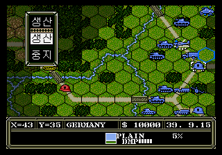
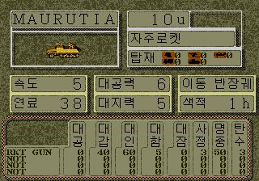
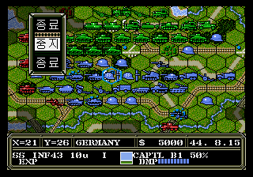
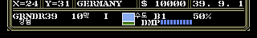

# 어드밴스드 대전략: 독일 전격작전 (메가드라이브) 한국어 패치

Advanced Daisenryaku: Deutsch Dengeki Sakusen (Mega Drive, 1991 SystemSoft) 한국어 패치입니다. **현재 v0.9.1 (미완성 초안 단계)**

| | | |
|---|---|---|
|  |  |  |
| 타이틀 | 전술 지도(생산 메뉴) | 유닛 정보창 |
|  |  |  |
| 작전 브리핑(총통 훈령) | 시나리오 38 전술 지도 | 상태 바(`수도`, `경험`) |

## 번역된 범위
- 작전 브리핑 43개 블록, 전황 서술 93개 블록
- 캠페인/STANDARD 메뉴, 전술 명령 메뉴, 유닛 정보창 라벨, 무기 성능표 머리글
- 하단 상태 바의 지형명과 `경험` 라벨은 8x8 한글 글리프로 표시합니다. (v0.9)
- 무장(159종)·유닛(690종)·국가·시나리오 이름은 **영문 대문자**(8자 이내)로 표기합니다. 해당 화면이 8x8 고정 타일 글꼴이라 한글을 다 넣을 수 없기 때문입니다.
- STANDARD 44개 시나리오 모두 전술 지도 도달을 확인했습니다.

## 패치 방법
이 저장소에는 **롬 파일이 없습니다.** 원본 롬을 직접 준비해 IPS 패치를 적용하세요.

1. 원본 롬 준비 (일본판 Rev.A)
   - 파일 크기 1,048,576 바이트
   - SHA-1 `842430c0465d810576e75851023929fec873580d`
   - SHA-256 `47360b90ee077c2df7bb8f8bb6f46bbea25d7e5b1fd975cdf507c1048d80b062`
2. IPS 패치 도구로 `patch/Advanced_Daisenryaku_ko_v0.9.1.ips` 를 원본 롬에 적용합니다. (Lunar IPS, Floating IPS(flips), 온라인 IPS 패처 등)
   - 예: `flips --apply Advanced_Daisenryaku_ko_v0.9.1.ips "Advanced Daisenryaku (J) (REV01) [!].gen" Advanced_Daisenryaku_ko_v0.9.1.md`
3. 결과 롬은 2,097,152 바이트(2MB)가 되며, SHA-1 이 아래와 같으면 정상입니다.
   - SHA-1 `4a426586a8ed817843cb6a3df175b246f14d721d`
4. 에뮬레이터(BizHawk, Genesis Plus GX 등)나 플래시카트에서 실행합니다.
   - 2MB 롬이므로 일반 메가드라이브 롬 매핑 기준입니다. 에뮬레이터 호환은 BizHawk 에서만 시험했습니다.

IPS 파일 SHA-256: `7565d5b9ac25be7a83be94a60cbcdc5b39e06324b437d62c5a7071337e6509a0`

## 한계 및 알려진 문제
- 상황표·부대표·수입표·개발표·유닛 세부 스펙창 등 일부 화면은 확인하지 못했고, 일본어가 남아 있을 수 있습니다.
- 엔딩·연표 등 일부 문자열은 화면에서 확인하지 못했습니다.
- 상태 바 지형명용 8x8 한글 글리프 32개는 원본 폰트의 가타카나/한자 슬롯 일부를 덮어썼습니다. 아직 확인하지 못한 서브메뉴가 그 코드를 쓰면 일본어 글자 자리에 한글이 나올 수 있습니다.
- 번역은 초안이며 계속 다듬는 중입니다.

## 변경 이력
[CHANGELOG.txt](CHANGELOG.txt) 참고.

## 라이선스 및 출처
- 한글 글꼴은 Galmuri(OFL 1.1)를 사용했습니다. [LICENSE_Galmuri_OFL.txt](LICENSE_Galmuri_OFL.txt)
- 게임의 저작권은 SystemSoft 및 원 권리자에게 있습니다. 이 저장소는 IPS 패치만 배포하며 롬은 배포하지 않습니다.
- 제작: hguyswow
