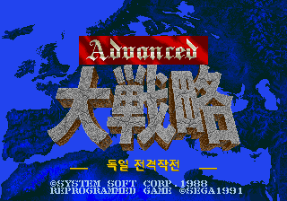
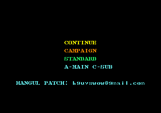

# Advanced Daisenryaku: German Blitzkrieg Operation (Mega Drive) Korean Language Patch

Advanced Daisenryaku: Deutsch Dengeki Sakusen (Mega Drive, 1991 SystemSoft) Korean Language Patch. **Currently v0.11 (incomplete draft)**

| | | |
|---|---|---|
|  |  | |
| Title screen (Korean subtitle) | Main menu (per-item colors) | |
|  |  |  |
| Title | Tactical Map (Production Menu) | Unit Info Window |
|  |  |  |
| Operation Briefing (Directive) | Scenario 38 Tactical Map | Status bar (terrain, EXP label) |

## Translated Ranges
- 43 operation briefing blocks, 93 situation description blocks
- Campaign/STANDARD menu, tactical command menu, unit info window labels, weapon performance table headers
- Main menu items now use different colors (v0.11).
- The yellow subtitle on the title screen is replaced with a Korean one (v0.10).
- Terrain names and the EXP label in the bottom status bar are shown with 8x8 Korean glyphs (v0.9).
- Arms (159 types), units (690 types), countries, and scenario names are written in **uppercase English** (8 characters or less). The screen uses a fixed 8x8 tile font that cannot hold all the Korean characters.
- Confirmed tactical map reachability for all 44 STANDARD scenarios.

## Patch Method
This repository does **not** include a ROM file. Prepare the original ROM yourself and apply the IPS patch.

1. Prepare the original ROM (Japanese Rev.A)
   - File size 1,048,576 bytes
   - SHA-1 `842430c0465d810576e75851023929fec873580d`
   - SHA-256 `47360b90ee077c2df7bb8f8bb6f46bbea25d7e5b1fd975cdf507c1048d80b062`
2. Apply `patch/Advanced_Daisenryaku_ko_v0.11.ips` to the original ROM using an IPS patch tool (Lunar IPS, Floating IPS(flips), online IPS patcher, etc.).
   - Example: `flips --apply Advanced_Daisenryaku_ko_v0.11.ips "Advanced Daisenryaku (J) (REV01) [!].gen" Advanced_Daisenryaku_ko_v0.11.md`
3. The resulting ROM will be 2,097,152 bytes (2MB), and if the SHA-1 matches the one below, it is correct.
   - SHA-1 `91a7bc945f3e673e69eb576d33c264520f22216e`
4. Run it in an emulator (BizHawk, Genesis Plus GX, etc.) or flash cart.
   - Since it is a 2MB ROM, it uses standard Mega Drive ROM mapping. Emulator compatibility was tested only with BizHawk.

IPS file SHA-256: `8cd2f048b0170d9f0d0d6f37603c850a4bb57b08cbf1fccf71b10213d6a20813`

## Limitations and Known Issues
- Some screens such as situation tables, unit tables, income tables, development tables, and unit detail spec windows could not be verified, and Japanese text may remain.
- Some strings such as endings and chronologies could not be confirmed on screen.
- The 32 Korean 8x8 glyphs for the status bar overwrite some katakana/kanji slots of the original font. If a submenu not yet checked uses those codes, Korean characters may appear in place of Japanese ones.
- The translation is a draft and is still being refined.

## Changelog
See [CHANGELOG.txt](CHANGELOG.txt).

## License and Sources
- The Korean font uses Galmuri (OFL 1.1). [LICENSE_Galmuri_OFL.txt](LICENSE_Galmuri_OFL.txt)
- The game's copyright belongs to SystemSoft and the original rights holders. This repository distributes only the IPS patch and does not distribute a ROM.
- Created by: hguyswow
